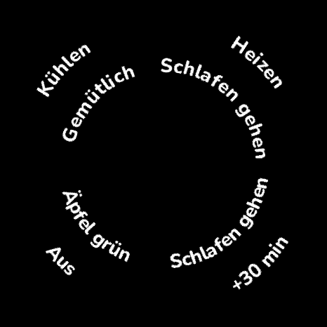

# Spike: curved text and reconnect at boot

Findings for issue #2. Measured on the StopWatch with ESPHome 2026.10.2 (LVGL 9.5.0, ESP-IDF) against Home Assistant 2026.9.3 (aioesphomeapi 46.2.0). The spike was `main` plus a throwaway header, which is not merged.

## Curved text: use `lv_arclabel`

LVGL 9.5's arc label renders curved text correctly, including umlauts and labels on the lower half. No per-character labels needed. Checked from LVGL snapshots of the rendered screen dumped over the log, and confirmed by eye on the panel.



```yaml
esphome:
  build_flags:
    - -DLV_USE_ARCLABEL=1
    - -DLV_DRAW_SW_SUPPORT_A8=1
    - -DLV_USE_FLOAT=1
```

- `LV_USE_ARCLABEL=1`: ESPHome generates `lv_conf.h` with every widget it has no YAML for set to 0. A define passed in `build_flags` is left out of that file, so the flag wins. ESPHome has no YAML widget for it; create it from C++ (`lv_arclabel_create`).
- `LV_DRAW_SW_SUPPORT_A8=1`: required. Rotated glyphs are drawn through the A8 image transform, which ESPHome disables. Without it the letters sit in the right place but are noise, and LVGL logs `lv_draw_sw_transform: Color format 0x0E is not enabled` per glyph. ([snapshot](curved-text-without-a8.png))
- `LV_USE_FLOAT=1`: optional, quality. Without it glyph angles use integer math and the spacing is visibly uneven ("H eizen"). With it the spacing is even. ESPHome's LVGL component and our UI compile unchanged with it.

Settings that gave the mockup's look, with a full-size (466×466) arc label centred on the display and the 28 px Nunito font:

- upper quarters: `LV_ARCLABEL_DIR_CLOCKWISE`; lower quarters: `LV_ARCLABEL_DIR_COUNTER_CLOCKWISE`, so the text reads left to right with the letter tops toward the centre
- `angle_start` = quarter centre − 42°, `angle_size` = 84°, horizontal and vertical align `CENTER` (LVGL angles: 0° right, 90° bottom)
- a 14-character label ("Schlafen gehen") fits a quarter at radius 140; at radius 200 there is room to spare

Cost: a full-screen snapshot with eight arc labels rendered in about 100 ms.

## Reconnect at boot: close the socket, ~0.3–0.5 s

The device can drop the API connection itself, using only public methods of `api::global_api_server->active_clients()`:

| Mechanism | Reconnect delay (drop → HA connected again) | n |
|---|---|---|
| `conn->on_fatal_error()` (closes the socket) | 275–502 ms | 10 |
| `conn->send_message(api::DisconnectRequest{})` | 5.1–8.2 s | 10 |

- The graceful `DisconnectRequest` is slow by design: aioesphomeapi treats it as an expected disconnect and waits `EXPECTED_DISCONNECT_COOLDOWN = 5.0` s before reconnecting. An abrupt close is reconnected immediately.
- The premise of ADR 0002 holds: a subscription added with `subscribe_home_assistant_state()` while connected never reached HA (0 of 20 trials, 10 s wait each). After the reconnect its first state arrived 0.3–0.5 s later, so a new subscription has its value roughly 0.6–1.0 s after an abrupt drop.
- First HA connection after a reset came 6–14 s after boot, about 0.6 s after Wi-Fi was up when HA was already retrying. After a long flash HA's backoff stretched this to 51 s once. The extra reconnect adds well under a second to that, so the fallback of sending the subscribe message by hand is not needed.
- `api: homeassistant_states: true` is required for runtime subscriptions when no `homeassistant` sensor is in the YAML.

Both mechanisms drop every API client, including a log viewer connected over the network.
